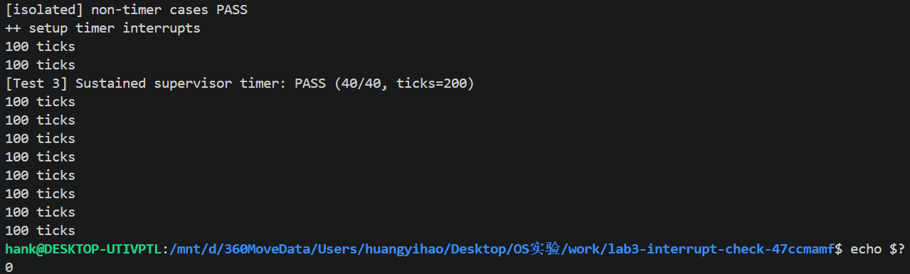
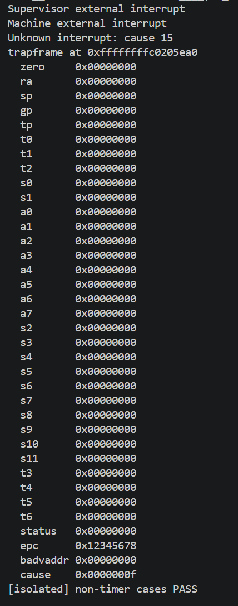

# 操作系统实验报告

## 实验基本信息

| 项目 | 内容 |
|---|---|
| 实验名称 | Lab3：中断与异常处理 |
| 小组成员 | 2412771-谭锦睿、2413581-黄奕浩、2411302-王乐之 |
| 完成日期 | 2026-11-06 |
| 实验分支 | `lab3` |
| 代码目录 | `code/` |
| 报告目录 | `report/` |

---

## 小组分工

### 练习分工

| 成员 | 负责内容 |
|---|---|
| 2412771-谭锦睿 | 功能一：Trap 入口与上下文恢复。负责 `trapentry.S` 中 `RESTORE_ALL` 和 `__alltraps` 的实现及相关代码分析。 |
| 2413581-黄奕浩 | 功能二：中断处理。负责 `trap.c` 中 `interrupt_handler()` 的实现，包括时钟中断及其他中断处理。 |
| 2411302-王乐之 | 功能二：异常处理。负责 `trap.c` 中 `exception_handler()` 的实现，包括断点异常、非法指令异常及其他异常处理。 |
| 三人共同完成 | 最终代码整合、编译运行、实验测试和报告整理。 |

### 任务完成情况

- [x] 功能一：Trap 入口与上下文恢复
- [x] 功能二：中断处理
- [x] 功能二：异常处理
- [x] 完成实验代码整合
- [x] 完成编译与运行验证
- [x] 完成实验报告
- [x] 整理实际使用的 Prompt

### 报告分工

| 成员 | 报告负责内容 |
|---|---|
| 2412771-谭锦睿 | Trap 入口、上下文保存与恢复 |
| 2413581-黄奕浩 | 中断处理部分 |
| 2411302-王乐之 | 异常处理部分 |
| 三人共同完成 | 实验结果、测试记录和最终报告整理 |

实际使用的 Prompt 统一整理在 `report/prompt.md`。

---

# 一、实验目的

本实验主要学习 RISC-V 架构下的中断与异常处理机制，理解处理器发生 Trap 后进入操作系统内核、保存现场、分类处理并恢复执行的完整过程，并完成基本的中断和异常处理功能。

主要目标如下：

1. 理解 Trap、Interrupt 和 Exception 的基本概念及其关系；
2. 理解 RISC-V 中与 Trap 处理有关的控制状态寄存器；
3. 理解 Trap 发生后处理器进入 Trap 处理程序的基本流程；
4. 理解 TrapFrame 及寄存器现场保存与恢复过程；
5. 完成 Trap 入口和上下文恢复代码；
6. 完成中断处理代码；
7. 完成异常处理代码；
8. 通过编译、QEMU 运行和实验测试验证实现结果。

---

# 二、实验环境

## 2.1 系统与开发环境

| 项目 | 环境 |
|---|---|
| 主机环境 | Windows + WSL2 Ubuntu 24.04 |
| 目标架构 | RISC-V 64 |
| 交叉编译工具链 | `riscv64-unknown-elf-*` |
| 虚拟机 | QEMU |
| 固件 | OpenSBI |
| 调试工具 | RISC-V GDB |
| 版本管理 | Git |
| 实验分支 | `lab3` |

## 2.2 AI 工具

| 成员 | AI 工具 | 用途 |
|---|---|---|
| 2412771-谭锦睿 | ChatGPT / Codex | 实验要求分析、代码理解、实现与检查辅助 |
| 2413581-黄奕浩 | ChatGPT / Codex | 中断处理实现与检查 |
| 2411302-王乐之 | ChatGPT / Codex | 异常处理实现与检查 |

完整 Prompt 见：

```text
report/prompt.md
```

---

# 三、实验整体逻辑分析

## 3.1 Lab3 主要内容

本实验在前面实验的基础上加入 RISC-V Trap 处理机制。主要实现文件为：

```text
kern/trap/trapentry.S
kern/trap/trap.c
```

其中：

```text
trapentry.S
    ├── SAVE_ALL
    ├── RESTORE_ALL
    ├── __alltraps
    └── __trapret

trap.c
    ├── idt_init()
    ├── trap()
    ├── trap_dispatch()
    ├── interrupt_handler()
    └── exception_handler()
```

此外，时钟中断还会使用 `kern/driver/clock.c` 中的 `clock_init()`、`clock_set_next_event()` 和 `ticks`，中断开关则与 `kern/driver/intr.c`、`kern/sync/sync.h` 中的相关接口有关。

## 3.2 Trap 处理总体流程

系统初始化时，`idt_init()` 将 `stvec` 设置为 `__alltraps`，`clock_init()` 打开时钟中断源并设置第一次时钟事件，之后由全局中断开关允许 S 态中断响应。

发生 Trap 后，处理器先更新 `sepc`、`scause`、`sstatus` 等 CSR，并跳转到 `stvec` 指向的 `__alltraps`。汇编入口通过 `SAVE_ALL` 将通用寄存器和关键 CSR 保存到栈上的 TrapFrame，再将 TrapFrame 指针传给 C 层的 `trap()`。

完整流程如下：

```text
初始化
    ↓
stvec = __alltraps
    ↓
发生 Trap
    ↓
CPU 更新 sepc / scause / sstatus 等 CSR
    ↓
__alltraps
    ↓
SAVE_ALL
    ↓
构造 TrapFrame
    ↓
trap(tf)
    ↓
trap_dispatch(tf)
    ↓
┌───────────────┬───────────────┐
│ Interrupt     │ Exception     │
│       ↓       │       ↓       │
│ interrupt_    │ exception_    │
│ handler()     │ handler()     │
└───────────────┴───────────────┘
    ↓
__trapret
    ↓
RESTORE_ALL
    ↓
sret
    ↓
恢复原执行流程
```

中断和异常共用同一套入口与返回机制，区别主要体现在 `trap_dispatch()` 之后的具体处理策略。

---

# 四、实验内容与实现

## 4.1 功能一：Trap 入口与上下文恢复

**负责人：2412771-谭锦睿**

### 4.1.1 任务要求

本任务主要涉及：

```text
kern/trap/trapentry.S
```

需要完成：

```text
RESTORE_ALL
__alltraps
```

现有框架已经提供 `SAVE_ALL`、`__trapret` 和 `sret` 等基本结构，本任务在此基础上完成上下文恢复以及汇编入口到 C 语言 Trap 处理函数的衔接。

### 4.1.2 主要涉及文件

```text
kern/trap/trapentry.S
kern/trap/trap.h
kern/trap/trap.c
```

### 4.1.3 实现过程

框架中的 `SAVE_ALL` 在 Trap 发生后先将原来的 `sp` 暂存到 `sscratch`，随后在栈上分配 `36 * REGBYTES` 的空间保存 TrapFrame。当前实验为 RV64，`REGBYTES = 8`，因此 TrapFrame 共占 288 字节。

前 32 个槽位对应 `x0 ~ x31`，其中第 2 个槽位保存 Trap 前的原 `sp`；后四个槽位分别保存 `sstatus`、`sepc`、`sbadaddr` 和 `scause`。

`RESTORE_ALL` 按照 `SAVE_ALL` 的布局进行反向恢复。首先恢复 Trap 返回所需的 `sstatus` 和 `sepc`，随后恢复通用寄存器。`x0` 在 RISC-V 中恒为 0，因此不需要恢复；`sp` 必须最后恢复，因为此前所有寄存器仍需要以当前 `sp` 作为 TrapFrame 的访问基址。

`__alltraps` 中首先执行框架已有的 `SAVE_ALL`。此时 `sp` 指向当前 TrapFrame，根据 RISC-V ABI，将 `sp` 放入参数寄存器 `a0`，再通过 `jal trap` 调用 C 层的 `trap(struct trapframe *tf)`。

`trap()` 返回后，程序顺序进入 `__trapret`，执行 `RESTORE_ALL`，最后由 `sret` 完成 Trap 返回。

### 4.1.4 关键代码

恢复 `sstatus` 和 `sepc`：

```asm
LOAD s1, 32*REGBYTES(sp)
LOAD s2, 33*REGBYTES(sp)
csrw sstatus, s1
csrw sepc, s2
```

恢复通用寄存器，并最后恢复 `sp`：

```asm
LOAD x1, 1*REGBYTES(sp)
LOAD x3, 3*REGBYTES(sp)
...
LOAD x31, 31*REGBYTES(sp)
LOAD x2, 2*REGBYTES(sp)
```

Trap 入口：

```asm
__alltraps:
    SAVE_ALL

    #lab3 function1 2412771
    move a0, sp
    jal trap
```

### 4.1.5 Prompt

完整 Prompt 见 `report/prompt.md`。本部分使用的核心约束为：

```text
[PROMPT]
完成 trapentry.S 中 RESTORE_ALL 和 __alltraps 的 Lab3 实现。

[RELY]
以现有 SAVE_ALL、TrapFrame 布局、trap()、RISC-V ABI 以及
REGBYTES/LOAD/STORE 定义为依据。

[GUARANTEE]
只修改本功能要求的位置，不修改 SAVE_ALL、__trapret、
测试代码及其他成员负责的中断和异常处理函数。

[SPECIFICATION]
按照 TrapFrame 布局恢复 sstatus、sepc 和通用寄存器，
sp 最后恢复；__alltraps 中将当前 TrapFrame 地址通过 a0
传给 trap()。
```

### 4.1.6 测试与验证

首先检查修改范围：

```bash
git diff --check
git diff --name-only
```

检查结果表明 `trapentry.S` 修改符合格式要求，且未修改其他成员负责的代码。

随后单独编译 Trap 入口汇编文件：

```bash
cd ~/os-lab/nku-os/code
make obj/kern/trap/trapentry.o V=
```

目标文件能够正常生成。进一步结合反汇编和最终整体测试确认：

- `a0` 被设置为当前 TrapFrame 地址；
- 能够正确调用 `trap()`；
- `sstatus` 和 `sepc` 能够正确写回；
- 通用寄存器按照 TrapFrame 布局恢复；
- `sp` 最后恢复；
- 返回流程最终执行 `sret`。

功能一最终随小组代码一起完成整体联调，并通过官方 Trap 入口与寄存器恢复测试。

---

## 4.2 功能二：中断处理

**负责人：2413581-黄奕浩**

### 4.2.1 任务要求

实现：

```c
void interrupt_handler(struct trapframe *tf);
```

函数位于：

```text
kern/trap/trap.c
```

`trap_dispatch()` 已经根据 `scause` 最高位将中断和异常分开，因此 `interrupt_handler()` 主要负责进一步识别具体的中断类型并完成对应处理。

时钟中断需要重新设置下一次事件、更新 `ticks`，并按照实验要求周期性打印；达到设定次数后通过 SBI 结束运行。其他已知中断输出相应提示，未知中断打印原因号及 TrapFrame。

### 4.2.2 主要涉及文件和调用关系

主要涉及：

```text
kern/trap/trap.c
kern/trap/trap.h
kern/driver/clock.c
libs/riscv.h
libs/sbi.h
```

调用关系为：

```text
__alltraps
    ↓
SAVE_ALL
    ↓
trap(tf)
    ↓
trap_dispatch(tf)
    ↓
interrupt_handler(tf)
    ↓
__trapret
    ↓
RESTORE_ALL
    ↓
sret
```

### 4.2.3 实现过程

RV64 的 `scause` 最高位用于表示当前 Trap 是否为中断。进入 `interrupt_handler()` 时已经确定当前为 Interrupt，因此首先清除最高位，只保留具体中断编号：

```c
uintptr_t cause = tf->cause & ~((uintptr_t)1 << 63);
```

随后通过 `switch` 处理不同中断。

本实验最主要的是 Supervisor Timer Interrupt。处理 `IRQ_S_TIMER` 时，首先调用 `clock_set_next_event()` 重新设置下一次时钟事件，再执行 `ticks++` 记录中断次数。

`clock_set_next_event()` 位于 `kern/driver/clock.c`，内部通过 `sbi_set_timer(get_time() + timebase)` 设置未来的定时器事件。该定时器需要在每次时钟中断后重新设置，否则后续时钟中断不会持续产生。

本实现沿用 `TICK_NUM = 100`，并设置 `SHUTDOWN_AFTER = 10`。因此每累计 100 次时钟中断打印一次，共打印 10 次后调用 `sbi_shutdown()`。

其他软件中断、定时器中断和外部中断按照原因号输出对应提示；未知中断输出原因号并调用 `print_trapframe(tf)` 打印现场，便于定位问题。

### 4.2.4 关键代码

```c
#define TICK_NUM 100
#define SHUTDOWN_AFTER 10
```

清除 `scause` 的中断标志位：

```c
uintptr_t cause = tf->cause & ~((uintptr_t)1 << 63);
```

时钟中断处理：

```c
case IRQ_S_TIMER:
    clock_set_next_event();
    ticks++;

    if (ticks % TICK_NUM == 0) {
        print_ticks();

        if (ticks / TICK_NUM >= SHUTDOWN_AFTER) {
            sbi_shutdown();
        }
    }
    break;
```

未知中断处理：

```c
default:
    cprintf("Unknown interrupt: cause %lu\n",
            (unsigned long)cause);
    print_trapframe(tf);
    break;
```

### 4.2.5 Prompt

完整 Prompt 见 `report/prompt.md`。本部分主要要求 AI 辅助确认中断原因编码、时钟中断处理顺序以及与现有 Trap 入口和恢复代码之间的接口关系，实际实现仍以当前工程已有接口和实验指导书为准。

### 4.2.6 测试与验证

首先对 `trap.c` 进行编译检查：

```bash
make obj/kern/trap/trap.o
```

编译通过。

整体代码合入后，通过 QEMU 和官方测试验证了以下内容：

- `IRQ_S_TIMER` 能够持续触发；
- 每次时钟中断都会重新设置下一次事件；
- `ticks` 能够持续增长；
- 每 100 次时钟中断打印一次 `100 ticks`；
- 达到设定次数后能够通过 SBI 正常结束运行；
- 未知中断能够输出原因及 TrapFrame；
- 中断处理不会修改异常处理所需的 `epc`。

官方时钟测试结果：

```text
re-armed supervisor timer and repeated trap return:
PASS (40/40, ticks=200)
```

运行过程中能够持续看到：

```text
++ setup timer interrupts
100 ticks
100 ticks
...
```

说明时钟事件能够被持续重新设置，并能够多次完成 Trap 进入和返回。

### 4.2.7 运行截图



图1中可以看到时钟初始化完成后持续输出 `100 ticks`，同时官方时钟测试在 `ticks=200` 时通过。继续运行到设定阈值后，系统通过 SBI 正常退出。



图2展示了不同中断类型的提示以及未知中断情况下的 TrapFrame 输出，说明中断分类和默认处理分支能够正常工作。

---

## 4.3 功能二：异常处理

**负责人：2411302-王乐之**

### 4.3.1 任务要求

实现：

```c
void exception_handler(struct trapframe *tf);
```

函数位于：

```text
kern/trap/trap.c
```

根据 Trap 原因处理对应异常。本实验主要关注：

```text
Illegal Instruction
Breakpoint
```

对于无法识别的异常，输出 TrapFrame 以便调试。

### 4.3.2 主要涉及文件

```text
kern/trap/trap.c
kern/trap/trap.h
```

同时与 `trapentry.S` 中的 TrapFrame 保存与恢复过程直接相关。

### 4.3.3 实现过程

`exception_handler()` 接收汇编入口保存的 TrapFrame。`trap_dispatch()` 已经根据 `scause` 最高位确认当前 Trap 为 Exception，因此本函数直接根据 `tf->cause` 判断具体异常类型。

本实验中：

- `CAUSE_ILLEGAL_INSTRUCTION` 对应非法指令；
- `CAUSE_BREAKPOINT` 对应断点异常；
- 其他原因打印完整 TrapFrame 后返回。

对于断点和非法指令，`sepc` 指向触发异常的指令。如果处理完以后不修改返回位置，执行 `sret` 后还会再次执行同一条指令，从而重复进入异常。

因此需要根据当前指令长度推进 `tf->epc`。RISC-V 同时存在 16 位压缩指令和 32 位普通指令，所以不能固定执行 `epc += 4`。本实现先读取 EPC 地址处的 16 位内容，根据指令最低两位判断长度：

```text
最低两位为 11 → 32 位指令 → EPC + 4
其他情况      → 16 位指令 → EPC + 2
```

修改后的 `tf->epc` 保存在 TrapFrame 中，之后由 `RESTORE_ALL` 写回 `sepc`，最终由 `sret` 从新的地址继续执行。

### 4.3.4 关键代码

```c
//lab3 function2 exception_handler 2411302
void exception_handler(struct trapframe *tf) {
    switch (tf->cause) {
    case CAUSE_ILLEGAL_INSTRUCTION:
        cprintf("Illegal instruction at 0x%016lx\n",
                (unsigned long)tf->epc);
        break;

    case CAUSE_BREAKPOINT:
        cprintf("Breakpoint at 0x%016lx\n",
                (unsigned long)tf->epc);
        break;

    default:
        print_trapframe(tf);
        return;
    }

    uint16_t instruction =
        *(const volatile uint16_t *)tf->epc;

    tf->epc +=
        (instruction & 0x3) == 0x3 ? 4 : 2;
}
```

### 4.3.5 Prompt

完整 Prompt 见 `report/prompt.md`。本部分主要使用 AI 辅助分析异常原因、EPC 推进方式以及 16/32 位指令长度判断，实际实现以已有 TrapFrame、异常原因宏和统一恢复流程为依据。

### 4.3.6 测试与验证

整体代码完成后执行编译和官方测试。异常相关测试主要覆盖：

- Breakpoint 能够正确进入异常处理；
- 处理完成后能够跳过触发异常的指令；
- Illegal Instruction 能够正确输出信息并继续执行；
- 32 位异常指令能够正确推进 4 字节；
- 16 位压缩指令按照 2 字节推进；
- 未识别异常能够打印 TrapFrame；
- 异常处理不会破坏其他寄存器现场。

官方测试结果：

```text
trap entry, register restore, and breakpoint EPC:
PASS (35/35)

illegal instruction EPC advance and return:
PASS (25/25)
```

补充检查中，16 位断点、32 位断点、16 位非法指令和 32 位非法指令均能够按照实际指令长度正确调整 EPC，说明当前处理方式能够兼容本实验涉及的 16/32 位指令。

---

# 五、关键知识理解

## 5.1 Trap、Interrupt 与 Exception

Trap 是处理器从当前执行流转入异常/中断处理流程的统一机制，其中包括 Interrupt 和 Exception。

Interrupt 是异步事件，例如时钟中断，与当前正在执行的具体指令没有直接因果关系；Exception 是同步事件，例如非法指令和断点，由当前执行的指令直接触发。

RV64 的 `scause` 最高位用于区分中断和异常，低位保存具体原因编号。`trap_dispatch()` 根据这一信息将 Trap 分发到 `interrupt_handler()` 或 `exception_handler()`。

## 5.2 TrapFrame

TrapFrame 是一次 Trap 发生时保存在栈上的 CPU 现场。当前结构包含 32 个通用寄存器槽以及：

```text
status
epc
badvaddr
cause
```

在 RV64 下共占 288 字节。

`SAVE_ALL` 将寄存器和关键 CSR 保存到 TrapFrame；C 层通过 `struct trapframe *tf` 读取或修改现场；`RESTORE_ALL` 再根据同一布局恢复 CPU 状态。

## 5.3 与 Trap 有关的 CSR

主要 CSR 作用如下：

```text
stvec     Trap 入口地址
sepc      Trap 返回相关 PC
scause    Trap 原因
sstatus   S 态运行状态和中断/特权级信息
stval     Trap 附加信息（代码中使用旧名 sbadaddr）
sscratch  S 态临时寄存器，本实验用于暂存原 sp
sie       各类 S 态中断源使能
```

初始化阶段通过 `stvec` 建立 Trap 入口；Trap 发生后硬件更新 `sepc`、`scause` 和 `sstatus`；汇编入口再将这些状态保存进 TrapFrame。

## 5.4 Trap 入口和返回过程

Trap 发生后，处理器根据 `stvec` 跳到 `__alltraps`。`SAVE_ALL` 保存完整现场后，`sp` 指向 TrapFrame，通过 `a0 = sp` 将现场指针传入 C 层。

处理结束后，`RESTORE_ALL` 恢复 `sstatus`、`sepc` 和通用寄存器，最后恢复 `sp`，再执行 `sret` 返回。

异常处理可以通过修改 `tf->epc` 改变最终写回的 `sepc`；时钟中断属于异步事件，因此不需要像断点或非法指令那样主动跳过当前指令。

## 5.5 时钟中断

时钟初始化位于 `kern/driver/clock.c`：

```c
void clock_init(void) {
    set_csr(sie, MIP_STIP);
    clock_set_next_event();
    ticks = 0;
}
```

其中：

- `set_csr(sie, MIP_STIP)` 打开 Supervisor Timer Interrupt 对应的中断源；
- `clock_set_next_event()` 设置第一次未来时钟事件；
- `ticks = 0` 初始化软件计数器。

下一次时钟事件通过：

```c
sbi_set_timer(get_time() + timebase);
```

设置。`sbi_set_timer()` 通过 SBI 请求 OpenSBI 设置底层 timer。

Timer 到期后进入统一 Trap 流程，在 `interrupt_handler()` 的 `IRQ_S_TIMER` 分支中重新调用 `clock_set_next_event()`，从而形成持续的周期性时钟中断。

`ticks` 使用 `volatile` 修饰，表示该变量可能在中断处理等当前代码之外的执行路径中发生变化，避免编译器对访问进行不合适的缓存或消除。

## 5.6 中断开关与临界区

`sie` 用于控制具体的中断来源，而 `sstatus.SIE` 是 S 态全局中断开关。

底层接口：

```c
intr_enable();
intr_disable();
```

直接控制 `sstatus.SIE`。

更高层的：

```c
local_intr_save(flag);
local_intr_restore(flag);
```

用于保存进入临界区之前的中断状态，暂时关闭中断，并在关键操作完成后恢复原来的状态。

例如物理内存分配过程中会修改空闲页链表等共享数据结构，因此需要避免在修改中途被异步中断打断。这体现了 Lab3 引入中断以后，内核代码开始需要考虑临界区、原子性和并发控制。

---

# 六、测试与验证

## 6.1 编译验证

在 `lab3` 分支的 `code` 目录执行：

```bash
make clean
make -j4
```

编译和链接成功，能够生成：

```text
bin/kernel
bin/ucore.img
```

说明 Trap 入口、中断处理和异常处理代码能够正确参与完整内核构建。

## 6.2 QEMU 运行验证

运行内核后能够看到时钟中断初始化信息，并持续输出：

```text
++ setup timer interrupts
100 ticks
100 ticks
...
```

累计达到设定次数后，通过 SBI 正常结束运行。

这说明：

- `clock_init()` 能够正确设置第一次时钟事件；
- Timer Interrupt 能够进入统一 Trap 处理流程；
- `interrupt_handler()` 能够重新设置下一次事件；
- `RESTORE_ALL + sret` 能够多次正常完成 Trap 返回。

## 6.3 官方测试

执行实验提供的测试后，结果为：

```text
trap entry, register restore, and breakpoint EPC:
PASS (35/35)

illegal instruction EPC advance and return:
PASS (25/25)

re-armed supervisor timer and repeated trap return:
PASS (40/40)

Total Score: 100/100
```

三项测试分别验证了：

1. Trap 入口、寄存器现场保存与恢复以及断点 EPC 调整；
2. 非法指令异常处理和返回位置推进；
3. 时钟中断持续重设、重复 Trap 返回以及 `ticks` 正常增长。

最终结果表明三部分代码能够正确衔接，形成完整的 Trap 处理闭环。

---

# 七、实验结果

本实验完成了 RISC-V 下 Trap 入口、上下文恢复、中断处理和异常处理的实现。

Trap 发生后，系统能够通过 `stvec` 进入统一汇编入口，在栈上建立 TrapFrame，并将现场传递给 C 层处理。`trap_dispatch()` 能够根据 `scause` 将事件正确分发到中断或异常处理函数。

在中断处理方面，Supervisor Timer Interrupt 能够持续触发，每次进入处理函数后重新设置下一次时钟事件并更新 `ticks`，最终按照实验要求完成周期性输出和正常关机。

在异常处理方面，Breakpoint 和 Illegal Instruction 能够正确识别。通过读取指令最低 16 位判断当前指令长度，能够分别处理 16 位压缩指令和 32 位普通指令，避免固定增加 4 字节导致返回位置错误。

完整代码通过编译、QEMU 运行和官方测试，最终测试结果为 100/100。

---

# 八、实验总结

本实验将 RISC-V 硬件提供的 Trap 机制与操作系统的软件处理流程完整连接起来。通过本次实验，我们对 Trap 的理解不再停留在“中断来了执行处理函数”这一层，而是进一步理解了从初始化、硬件记录 CSR、汇编保存现场、C 层分发处理，到恢复现场和 `sret` 返回的完整过程。

在 Trap 入口部分，`SAVE_ALL` 和 `RESTORE_ALL` 体现了操作系统对 CPU 执行现场的管理，TrapFrame 则成为汇编层和 C 层之间传递状态的统一数据结构。`stvec`、`sepc`、`scause`、`sstatus` 等 CSR 分别承担 Trap 入口、返回位置、原因和处理器状态等作用。

在中断处理部分，通过时钟中断进一步理解了 `sie` 与 `sstatus.SIE` 的区别，以及 `clock_set_next_event()` 和 SBI timer 的关系。每次时钟中断后重新设置下一次事件，才能形成持续的周期性中断。

在异常处理部分，通过 Breakpoint 和 Illegal Instruction 的处理理解了同步异常与异步中断在返回语义上的区别。异常处理需要根据具体指令长度调整 EPC，而时钟中断通常保持原有返回位置。

此外，中断机制的引入也使内核代码开始需要考虑临界区和并发问题。`local_intr_save()` / `local_intr_restore()` 通过保存并恢复原中断状态，为共享数据结构的关键操作提供了基本保护。

最终三位成员负责的 Trap 入口、中断处理和异常处理能够正确衔接，官方测试全部通过。通过本实验，对 RISC-V Trap 机制以及操作系统中断、异常和上下文恢复过程形成了较完整的认识。
