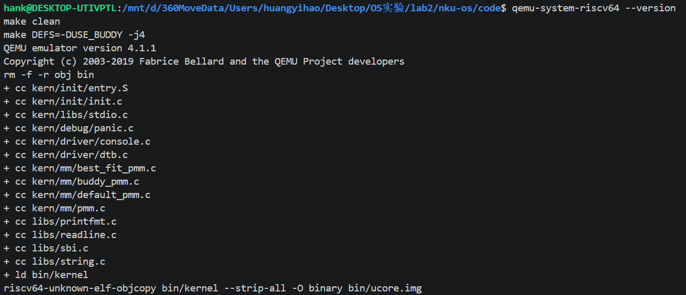
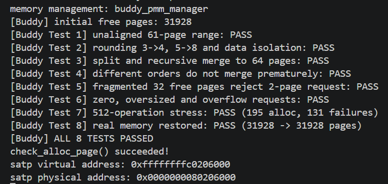

# 操作系统实验报告

## 实验基本信息

| 项目 | 内容 |
|---|---|
| **实验名称** | Lab2：物理内存和页表 |
| **小组成员** | 2412771-谭锦睿、2413581-黄奕浩、2411302-王乐之 |
| **完成日期** | 2026-10-18 |
| **实验分支** | `lab2` |
| **代码目录** | `code/` |
| **报告目录** | `report/` |

---

## 小组分工

### 练习分工

| 成员 | 负责内容 |
|---|---|
| **2412771-谭锦睿** | **功能模块一全部内容 + 功能模块二任务一、任务二**。负责物理内存探测与页描述符初始化；理解并分析 First-Fit；设计 Prompt 并完成完整 Best-Fit 分配器实现及 `pmm_manager` 切换；负责整体代码整合与基础测试。 |
| **2413581-黄奕浩** | **功能模块二任务三：Buddy System（伙伴系统）**。负责设计两份 Prompt，生成 Buddy System 分配模块及对应测试函数，完成接入、运行和结果分析。 |
| **2411302-王乐之** | **功能模块二扩展任务 Challenge：SLUB 分配算法**。负责设计两份 Prompt，生成简化 SLUB 内存对象分配模块及对应测试函数，完成接入、运行和结果分析。 |
| **三人共同完成** | **分支任务：GDB 调试页表查询过程**。共同完成 Sv39 页表查询过程的调试、地址拆分、PTE 逐级查看、物理地址计算和截图记录。 |

### 任务覆盖检查

根据实验指导书，Lab2 当前需要覆盖的内容如下：

- [x] 功能模块一任务一：实现物理内存探测与页描述符初始化功能 —— 谭锦睿
- [x] 功能模块一 Challenge：硬件可用物理内存范围的获取方法 —— 谭锦睿
- [x] 功能模块二任务一：理解 First-Fit 连续物理内存分配算法 —— 谭锦睿
- [x] 功能模块二任务二：实现 Best-Fit 连续物理内存分配算法 —— 谭锦睿
- [x] 功能模块二任务三：Buddy System 分配算法 —— 黄奕浩
- 功能模块二扩展任务 Challenge：任意大小内存单元 SLUB 分配算法 —— 待对应负责人完成后补充。
- 分支任务：GDB 调试页表查询过程 —— 待三人共同完成后补充。


### 报告分工

| 成员 | 报告负责内容 |
|---|---|
| **2412771-谭锦睿** | 实验整体逻辑、功能模块一、功能模块一 Challenge、功能模块二任务一、任务二、First-Fit 与 Best-Fit 对比、基础测试与 Git 整合 |
| **2413581-黄奕浩** | 功能模块二任务三 Buddy System：两份 Prompt、算法实现、测试设计、运行结果与分析 |
| **2411302-王乐之** | 功能模块二 SLUB Challenge：两份 Prompt、算法实现、测试设计、运行结果与分析 |
| **三人共同完成** | GDB 页表查询分支任务、Sv39 地址转换分析、调试记录与截图整理 |

> 最终报告以真实代码、实际 Git commit、QEMU/GDB 运行结果和实际使用的 Prompt 为准，不虚构尚未完成的实验结果。

---

# 一、实验目的

本实验主要围绕物理内存的发现、初始化、页级分配以及页表查询展开。实验目标如下：

1. 理解 RISC-V Sv39 页表和虚拟地址到物理地址的转换过程。
2. 理解操作系统如何通过 DTB 获取机器的物理内存范围。
3. 理解 `struct Page`、`pages`、`npage`、`nbase` 和 `va_pa_offset` 等数据结构与地址之间的关系。
4. 完成物理内存探测、页描述符初始化和初始空闲页区间建立。
5. 理解 First-Fit 连续物理页分配算法的初始化、分配、释放和空闲块合并过程。
6. 在 First-Fit 基础上实现 Best-Fit 连续物理页分配器。
7. 通过 Buddy System 与 SLUB 扩展任务进一步理解页级分配和任意大小内存对象分配。
8. 使用 QEMU、GDB、`make grade` 和 Git 对实现进行调试、验证与协作开发。
9. 在 AI 辅助开发过程中学习将实验要求写成明确的 Prompt/Spec，并对 AI 生成代码进行人工检查与验证。

---

# 二、实验环境

## 2.1 系统与开发环境

| 项目 | 环境 |
|---|---|
| 主机环境 | Windows + WSL2 Ubuntu 24.04 |
| 目标架构 | RISC-V 64 |
| 交叉编译工具链 | SiFive GCC-Metal 10.2.0（`riscv64-unknown-elf-*`） |
| 虚拟机 | QEMU 4.1.1，RISC-V `virt` 机器 |
| 固件 | 课程环境对应的旧版 OpenSBI |
| 调试工具 | RISC-V GDB |
| 版本管理 | Git + GitHub |
| 实验分支 | `lab2` |

实验初期误用了系统 QEMU 8.2.2，导致老师原始启动方式无法正常进入 uCore。后续按照课程要求切换至 QEMU 4.1.1，并恢复老师原始 `Makefile` 和 `entry.S` 后，系统正常运行并通过官方评分。

## 2.2 AI 工具

| 成员 | AI 编程工具 | 底层模型 | 用途 |
|---|---|---|---|
| 2412771-谭锦睿 | Codex | GPT-5 | `page_init()` 与 Best-Fit 的 Prompt 设计、源码核对和测试辅助 |
| 2413581-黄奕浩 | Codex | GPT-6 | Buddy System 分配模块、测试设计与源码核对 |
| 2411302-王乐之 | 待对应负责人补充 | — | SLUB 模块与测试 |

---

# 三、实验整体逻辑分析

## 3.1 实验主线

本实验的整体流程可以概括为：

```text
QEMU / OpenSBI
        ↓
entry.S 保存 hartid / DTB 地址并建立启动地址映射
        ↓
kern_init()
        ↓
dtb_init()
        ↓
从设备树获取物理内存范围
        ↓
pmm_init()
        ↓
init_pmm_manager()
        ↓
page_init()
        ↓
建立 Page[]、保留已用区域、登记初始空闲页
        ↓
First-Fit 代码阅读与理解
        ↓
Best-Fit 实现并切换 pmm_manager
        ↓
QEMU / make grade 验证
```


实验指导书给出的核心调用链为：

```text
pmm_init()
    ↓
init_pmm_manager()
    ↓
page_init()
    ↓
init_memmap()
    ↓
alloc_pages() / free_pages()
```

这条链把“发现物理内存”“组织物理页”“登记空闲页”“分配页面”“释放页面”连接成一个完整的物理内存管理过程。

## 3.2 关键数据结构

- `struct Page`：描述一个物理页的元数据。
- `pages`：`Page` 描述符数组的起始地址。
- `npage`：当前可管理物理内存上界对应的物理页号。
- `nbase`：DRAM 起始物理页号。
- `va_pa_offset`：内核虚拟地址与物理地址之间的偏移。
- `free_area_t`：保存空闲块链表和空闲页总数。
- `free_list`：连续空闲物理页块的链表。
- `nr_free`：当前空闲物理页总数。
- `property`：对空闲块头而言，表示该连续空闲块包含的页数。
- `PG_reserved`：页面是否被保留、不可由普通分配器使用。
- `PG_property`：该 `Page` 是否为空闲连续块的块头。
- `pmm_manager`：通过函数指针统一抽象不同物理页面分配算法。

---

# 四、实验内容与实现

## 4.1 功能模块一：物理内存初始化功能

### 4.1.1 任务一：实现物理内存探测与页描述符初始化功能

**负责人：2412771-谭锦睿**

#### 任务要求

实现：

```c
static void page_init(void);
```

所在文件：

```text
kern/mm/pmm.c
```

该函数需要：

1. 从设备树获取物理内存起始地址和大小；
2. 设置虚实地址映射偏移；
3. 计算可管理物理页范围；
4. 在内核 `end` 之后建立 `Page` 描述符数组；
5. 保证 OpenSBI、内核镜像以及 `Page[]` 描述符数组占用的空间不会被作为空闲页分配；
6. 对页面边界进行正确的向上/向下对齐；
7. 将剩余完整物理页通过 `init_memmap()` 交给当前 `pmm_manager`；
8. 当设备树信息无效时终止初始化；当不存在完整可用页时不调用 `init_memmap()`。

#### 主要涉及文件

```text
kern/driver/dtb.c
kern/driver/dtb.h
kern/mm/pmm.c
kern/mm/pmm.h
kern/mm/memlayout.h
kern/mm/mmu.h
tools/kernel.ld
```

#### 实现思路

当前实现的主要流程为：

```text
get_memory_base() / get_memory_size()
        ↓
得到 DTB 提供的 DRAM 范围
        ↓
设置 va_pa_offset
        ↓
计算并向下对齐 managed_end
        ↓
计算 npage 与 Page 描述符数量
        ↓
pages = ROUNDUP(end, PGSIZE)
        ↓
PADDR(pages) 得到描述符数组对应的物理地址
        ↓
初始化 Page[] 并默认全部设为 Reserved
        ↓
跳过 Page[] 实际占用空间
        ↓
向上对齐得到 free_start
        ↓
init_memmap(pa2page(free_start), free_pages)
```

当前代码还增加了对无效内存范围、地址加法溢出、描述符数组越界等情况的检查。

#### 关键理解

`Page[]` 并不是真实物理页本身，而是“每个物理页对应的一条管理记录”。例如，一个 `Page` 描述符可以记录该物理页是否保留、引用计数、空闲块长度和链表节点。

`Page[]` 本身也存放在实际内存中，所以它占用的物理空间不能再次被交给页面分配器。初始可分配空间必须从描述符数组结束位置之后的下一个完整页开始。

#### Prompt 设计

本任务使用四段式 Prompt 约束修改范围、可依赖接口和最终行为；完整版本见 [`prompt.md`](./prompt.md)。报告中保留的精简版如下：

```markdown
[PROMPT]
实现 `kern/mm/pmm.c` 中的 `page_init()`，完成从 DTB 内存信息到 `Page[]` 和初始空闲页区间的建立。

[RELY]
仅使用当前工程真实的 DTB、地址转换、页面对齐、`struct Page` 和 `init_memmap()` 接口。

[GUARANTEE]
不得修改测试；正确设置全局内存管理变量，并排除内核与 `Page[]` 占用区域。

[SPECIFICATION]
初始化页描述符，只将对齐后的完整可用页交给当前 `pmm_manager`，并处理无效范围和边界情况。
```

#### 验证结果

`page_init()` 已完成并通过完整工程编译。课程评分脚本注入的 Page Init 测试输出 `[Test 1] Page Init: PASS`，`make grade` 对应检查为 `OK`，最终评分为 20/20。

---

### 4.1.2 Challenge：硬件的可用物理内存范围的获取方法

**负责人：2412771-谭锦睿**

该 Challenge 为选做思考题：

> 如果 OS 无法提前知道当前硬件的可用物理内存范围，有什么办法让 OS 获取可用物理内存范围？


#### 最终回答

如果操作系统无法在编译时提前知道机器的物理内存范围，就需要在启动阶段从硬件平台、固件或 Bootloader 获取内存布局信息，而不能直接在内核中写死物理内存大小。

在本实验使用的 RISC-V 平台中，可以通过 **Device Tree（DTB）** 获取这部分信息。QEMU 启动机器时会生成描述当前硬件的设备树，OpenSBI 在把控制权交给 uCore 时，同时将 DTB 的地址传递给内核。内核可以解析设备树中的 `memory` 节点及其 `reg` 属性，得到物理内存的起始地址和容量。本实验中的 `dtb_init()` 就采用了这种方法，并通过 `get_memory_base()` 和 `get_memory_size()` 将探测结果提供给 `page_init()`。

在其他体系结构或启动环境中也有类似机制。例如 x86 平台可以通过 BIOS 的 E820 内存映射获取可用和保留的物理地址区间，使用 UEFI 启动时可以由 UEFI 提供 Memory Map，Bootloader 也可以在启动参数中把探测到的内存布局传给内核。

需要注意的是，获得物理 RAM 的总范围后，并不意味着这些地址都可以直接用于页面分配。操作系统还需要排除固件、Bootloader、内核镜像、页表、物理页描述符数组以及其他保留区域，最后才能得到真正可以交给物理内存分配器管理的空闲页。

因此，更一般地说，操作系统获取可用物理内存范围的过程可以概括为：

1. 由固件、Bootloader 或硬件描述机制探测机器的物理内存布局；
2. 在启动时把内存布局传递给操作系统；
3. 内核解析得到 RAM 的物理地址范围；
4. 排除固件、内核和其他保留区域；
5. 将剩余的完整物理页登记到物理内存管理器中。

在本实验中，这条过程具体体现为：

`QEMU → OpenSBI → DTB → dtb_init() → get_memory_base()/get_memory_size() → page_init() → init_memmap()`。

---

## 4.2 功能模块二：物理内存分配功能

### 4.2.1 任务一：理解 First-Fit 连续物理内存分配算法

**负责人：2412771-谭锦睿**

#### 任务性质

本任务属于代码阅读与思考题，不需要修改源码。主要通过阅读 `kern/mm/default_pmm.c` 中的 `default_init()`、`default_init_memmap()`、`default_alloc_pages()` 和 `default_free_pages()`，理解 First-Fit 连续物理页分配器的初始化、分配、释放以及相邻空闲块合并过程。

#### First-Fit 分配器工作过程

First-Fit 使用空闲链表 `free_list` 管理连续空闲物理页块，并通过 `nr_free` 记录当前所有空闲物理页的总数。

`default_init()` 负责初始化物理内存管理器内部状态。函数将 `free_list` 初始化为空链表，并将 `nr_free` 置为 0。此时只是建立了空闲内存的管理结构，还没有真正向其中登记可用物理页。

`default_init_memmap(base, n)` 用于将一段连续的 `n` 个物理页登记为空闲区域。函数首先初始化这段物理页对应的 `Page` 描述符，然后把 `base` 作为这一连续空闲块的块头。块头的 `property` 被设置为 `n`，表示从该页面开始共有 `n` 个连续空闲页，同时设置 `PG_property` 标志，并通过 `page_link` 将块头加入 `free_list`。因此，链表中记录的是一个个连续空闲块的块头，而不是将每个空闲页都单独加入链表。

`default_alloc_pages(n)` 负责分配连续的 `n` 个物理页。函数从 `free_list` 的起始位置顺序向后遍历，当遇到第一个满足 `p->property >= n` 的空闲块时立即停止查找并使用该块，这就是 First-Fit 中“First”的含义。

如果找到的空闲块大小正好等于申请页数，则整个空闲块直接被分配；如果该空闲块大于申请页数，则从块的前部取出 `n` 页进行分配，剩余部分重新组成一个新的空闲块，并更新新的块头、`property`、`PG_property` 和链表位置。完成分配以后，`nr_free` 减少实际分配出去的页数。

例如当前依次存在 2 页、8 页、5 页和 20 页四个空闲块，此时申请 4 个连续物理页。First-Fit 首先检查 2 页空闲块，发现空间不足；接着检查 8 页空闲块，发现能够满足要求，于是立即选择该块，不再继续寻找后面的 5 页和 20 页空闲块。随后从 8 页块中分配前 4 页，剩余 4 页继续作为新的空闲块进行管理。

`default_free_pages(base, n)` 负责回收已经分配的连续物理页。页面释放后，函数先重新初始化这些页面的状态，将 `base` 设置为新的空闲块头，并按照物理地址顺序将这个空闲块重新插入 `free_list`。

插入完成后，函数继续检查新释放的空闲块能否与前后的空闲块进行合并。如果前一个空闲块结束后的第一页正好就是当前 `base`，也就是满足 `previous + previous->property == base`，说明两个空闲块在物理地址上连续，可以合并。如果当前空闲块结束后的第一页正好是后一个空闲块，即满足 `base + base->property == next`，则也可以继续与后一个空闲块合并。

在合并过程中，只是将多个连续空闲块重新组织成一个更大的空闲块，并没有产生新的空闲页面，因此 `nr_free` 只在真正释放 `n` 个页面时增加一次，不会因为后续合并再次增加。

#### 原有 First-Fit 算法是否有进一步的改进空间

我认为原有的 First-Fit 算法仍然存在进一步的改进空间。

首先，当前实现使用按物理地址排列的链表保存空闲块，申请物理页时需要从链表头开始顺序查找第一个能够满足要求的空闲块。当系统运行时间较长、空闲块数量较多时，可能需要遍历大量链表节点，查找效率会下降。

其次，First-Fit 在反复进行内存分配和释放以后可能产生较多外部碎片。即使系统中剩余的空闲物理页总数仍然很多，如果这些页面被分散成大量较小的连续区域，也可能无法满足较大的连续物理页申请。

一种改进方式是使用 Best-Fit。Best-Fit 会在所有能够满足请求的空闲块中选择大小最接近请求大小的空闲块，而不是直接使用第一个满足条件的空闲块，这样能够减少单次分割后留下的剩余空间。不过如果仍然采用普通链表进行管理，Best-Fit 通常需要检查更多空闲块，而且也可能形成大量很小的碎片。

此外，还可以采用按块大小分类的空闲链表、树结构或者 Buddy System 等方式改进物理内存管理。Buddy System 通过按照 2 的幂次大小组织内存块，可以较方便地完成内存的分割和合并，但也可能产生一定的内部碎片。

因此，我认为 First-Fit 的主要改进方向是提高空闲块查找效率、优化空闲块选择策略，并采用更加适合快速分割和合并的数据结构。

### 4.2.2 任务二：实现 Best-Fit 连续物理内存分配算法

**负责人：2412771-谭锦睿**

#### 任务要求

本任务要求参考 `kern/mm/default_pmm.c` 中已有的 First-Fit 实现，在 `kern/mm/best_fit_pmm.c` 中补充完整的 Best-Fit 连续物理内存分配器。

原文件仅提供 `basic_check()` 和 `best_fit_check()` 两个测试函数，因此需要自行补充空闲区管理、初始化、物理页分配、物理页释放、相邻空闲块合并、空闲页统计以及 `best_fit_pmm_manager` 注册结构。同时还需要在 `kern/mm/pmm.c` 中将当前物理内存管理器切换为 `best_fit_pmm_manager`。

实现过程中不修改框架提供的 `basic_check()` 和 `best_fit_check()`。

#### 实现过程

Best-Fit 与 First-Fit 使用相同的基本空闲页组织方式，通过 `free_area` 保存空闲链表 `free_list` 和当前空闲物理页总数 `nr_free`。每个连续空闲块只将起始页加入链表，并通过块头的 `property` 保存该连续空闲块包含的页数。

初始化阶段，`best_fit_init()` 将空闲链表初始化为空，并将 `nr_free` 设置为 0。`best_fit_init_memmap(base, n)` 用于登记初始连续空闲页，将 `base` 设置为空闲块头，记录 `property = n`，设置 `PG_property`，并按照物理地址顺序插入 `free_list`。

Best-Fit 的主要区别体现在页面分配阶段。`best_fit_alloc_pages(n)` 不会在发现第一个满足要求的空闲块后立即停止，而是遍历整个空闲链表，对所有满足 `property >= n` 的空闲块进行比较，并保存其中大小最小的空闲块。

其选择条件为 `p->property >= n && (page == NULL || p->property < page->property)`。因此，只有当前空闲块能够满足申请，并且比之前找到的候选块更小时，才会更新最终选择。

例如空闲块依次为 2 页、8 页、5 页和 20 页，当申请 4 个连续物理页时，First-Fit 会在遇到 8 页块后立即使用它，而 Best-Fit 会继续遍历后续空闲块，最终选择能够满足申请且大小更接近请求的 5 页块。

选定空闲块以后，如果空闲块大小正好等于申请页数，则直接将整个块从空闲链表中删除；如果空闲块大于申请页数，则从低地址一侧分配前 `n` 页，剩余部分重新建立为空闲块，并设置新的 `property` 和 `PG_property`。最后将 `nr_free` 减少实际分配出去的页数。

页面释放由 `best_fit_free_pages(base, n)` 完成。函数首先恢复释放区域中各个页面的状态，将 `base` 重新设置为空闲块头，并令 `property = n`。随后按照物理地址顺序将该块插回 `free_list`。

插入完成后，分别检查释放块与前一个、后一个空闲块是否连续。如果前一个空闲块结束后的第一页正好等于当前块的起始页，则将两者合并；完成前向合并后，再继续检查当前合并块是否与后一个空闲块相邻，从而可以同时完成前后两个方向的连续空闲区域合并。

整个过程中，`nr_free` 只在实际分配和释放物理页时发生变化。空闲块之间的合并只是改变空闲空间的组织方式，并不会改变空闲物理页总数。

在实现过程中还发现了空闲链表尾部插入的一个细节：当新空闲块已经插入链表尾部后，需要立即结束当前遍历，否则后续循环可能再次访问刚刚插入的节点，影响双向链表结构。因此在尾部插入完成后增加了相应的退出处理。

完成 Best-Fit 实现后，在 `pmm.c` 的 `init_pmm_manager()` 中将当前管理器修改为 `best_fit_pmm_manager`，从而使后续的 `alloc_pages()` 和 `free_pages()` 实际调用本任务实现的 Best-Fit 分配器。

#### Prompt 设计

完整 Prompt 见 [`prompt.md`](./prompt.md)。报告中保留的精简版如下：

```markdown
[PROMPT]
补全 `kern/mm/best_fit_pmm.c`，并在 `kern/mm/pmm.c` 中切换到 `best_fit_pmm_manager`。

[RELY]
所有结构、宏和链表接口以当前工程的 First-Fit、PMM 和测试代码为准。

[GUARANTEE]
不得修改 `basic_check()`、`best_fit_check()` 和评分脚本；完整实现并注册 Best-Fit 管理器。

[SPECIFICATION]
遍历全部候选块并选择最小可用块，正确完成分割、按地址释放、相邻块合并及空闲页计数维护。
```

#### 测试与验证

本任务完成后，在课程要求的 QEMU 4.1.1 环境中重新进行完整编译与评分测试。

`best_fit_pmm.c` 可以正常编译，`basic_check()` 和 `best_fit_check()` 均保持框架原始内容未修改，`pmm_manager` 已正确切换为 `best_fit_pmm_manager`。

运行过程中可以正常看到 `memory management: best_fit_pmm_manager` 和 `check_alloc_page() succeeded!`，说明系统已经实际使用本任务实现的 Best-Fit 管理器。

最终执行 `make grade` 得到：

`-check page init: OK`

`-check best fit: OK`

`Total Score: 20/20`

因此，Best-Fit 的分配、分割、释放、相邻块合并以及空闲页数量维护均通过课程提供的测试。

#### Best-Fit 是否还有改进空间

我认为 Best-Fit 算法仍然存在进一步的改进空间。

当前实现虽然能够选择满足申请要求的最小空闲块，但为了找到这个块，每次分配通常需要遍历整个空闲链表。当系统中空闲块数量较多时，查找开销会明显增加，因此使用普通链表实现的 Best-Fit 在分配效率方面并不理想。

此外，Best-Fit 每次倾向于选择与申请大小最接近的空闲块，这虽然可以减少单次分割后剩余空间的大小，但长期运行后也可能产生大量很小的空闲块。这些小块难以满足较大的连续页面申请，因此仍然存在外部碎片问题。

一种改进方式是改变空闲块的组织结构，例如按照空闲块大小进行分类，使用分级链表、平衡树等数据结构，使系统能够更快地找到大小合适的空闲块，而不需要每次遍历全部链表。

还可以采用 Buddy System。Buddy System 按照 2 的幂次大小组织物理内存，可以较高效地完成内存块的分割和合并，并减少查找和合并的复杂度。不过这种方法也可能因为按固定大小分配而产生一定的内部碎片。

因此，Best-Fit 的主要改进方向仍然是在查找效率、内存碎片、合并效率以及实现复杂度之间取得更好的平衡。

### 4.2.3 任务三：Buddy System（伙伴系统）分配算法

**负责人：2413581-黄奕浩**

本任务在现有 uCore 物理内存管理框架上实现 Buddy System，并设计对应测试。新增文件为 `kern/mm/buddy_pmm.c` 和 `buddy_pmm.h`，`pmm.c` 只增加管理器头文件和条件选择，未改动 `page_init()`、Makefile、原有分配器及官方测试。两份四段式提示词分别用于分配模块和测试函数，完整内容见 [prompt1.md](./prompt1.md)，原 `prompt.md` 保持不变。

我使用按阶分类的空闲链表管理物理页，第 `order` 阶管理 `2^order` 页大小的块，范围为 0 至 20 阶。空闲块头设置 `PG_property`，并用 `property` 保存实际块页数；`nr_free` 统计所有空闲物理页。已分配块头使用 `flags` 的独立第 2 位标识，`property` 改为记录原申请页数。第 3 位只在一致性检查期间临时标记已访问的空闲页，检查结束即清除，不改变 `struct Page`。

初始化时，`buddy_init()` 建立各阶空链表，`buddy_init_memmap(base, n)` 初始化可用区间内的描述符，再根据绝对物理页号 `page2ppn(base)` 的对齐条件和剩余长度，每次登记能够容纳的最大二次幂块。因此，即使初始空闲区起点不对齐、长度不是二次幂，也能完整登记，不会简单截去边界页。固件、内核和描述符数组占用的区域仍由原有 `page_init()` 保留。

分配时，`buddy_alloc_pages(n)` 先检查请求是否为 0、是否超出空闲页数或最大阶，再将请求向上取整为二次幂，从能够满足请求的最小非空阶取块。如果取到的块较大，就逐级分成两半，保留低地址半块，另一半加入下一阶链表，直到达到目标阶。

例如，申请 3 页实际占用 4 页，申请 5 页实际占用 8 页，`nr_free` 应分别减去 4、8，而不是 3、5。调用者必须使用原申请地址和原请求数释放，如 `free_pages(p, 3)`，分配器依据记录回收整个 4 页块，不支持部分释放。这个约定避免了向上取整后多余页面无法回收的问题，但也说明 Buddy 存在内部碎片。

释放时，`buddy_free_pages(base, n)` 首先核对已分配块头标志、原请求数和块边界，再清理整个实际块的页状态并恢复空闲计数。伙伴物理页号通过 `buddy_ppn = ppn XOR (1 << order)` 计算。只有伙伴处于有效范围、为空闲块头且大小相同，才从链表摘除伙伴，以较低地址作为新块头并升一阶，继续递归合并。仅仅物理地址相邻，并不意味着两个块一定能够合并。

管理器通过 `buddy_pmm_manager` 注册，包含初始化、登记、分配、释放、空闲页查询和 `buddy_check()`。`pmm.c` 在定义 `USE_BUDDY` 时选择该管理器，未定义时继续选择 `best_fit_pmm_manager`。原 Makefile 已经把 `$(DEFS)` 加入编译参数，因此无须修改构建规则，运行命令为：

```bash
make clean
make DEFS=-DUSE_BUDDY -j4
make qemu DEFS=-DUSE_BUDDY
```

两种算法共享原有构建目录，切换前必须执行 `make clean`，避免复用上一种配置的目标文件。恢复默认 Best-Fit 时执行 `make clean`、`make -j4` 和 `make qemu`。

本次于 2026-10-21 在 WSL2 Ubuntu、QEMU 4.1.1、`riscv64-unknown-elf-gcc` 13.2.0 环境下完成编译和实际运行。终端显示 `memory management: buddy_pmm_manager`，确认执行的是 Buddy 实现。算法的查阶、分裂与合并最多经过 20 次升降阶；释放时还需要逐页重置描述符，因此整个释放函数包含与实际块页数成正比的开销。当前实现面向实验的单核启动环境，尚未增加并发同步。



图 1：本人 Ubuntu 终端实际运行结果。QEMU 版本为 4.1.1，执行 `make clean` 和 `make DEFS=-DUSE_BUDDY -j4` 后，Buddy 源文件编译成功，并完成内核链接及 `bin/ucore.img` 生成。

---

### 4.2.4 Challenge：任意大小的内存单元 SLUB 分配算法

**负责人：2411302-王乐之**

待对应负责人完成后补充。

---

## 4.3 First-Fit 与 Best-Fit 对比分析

**负责人：2412771-谭锦睿**

根据当前 `default_pmm.c` 和 `best_fit_pmm.c` 的真实实现，两种算法对比如下：

| 对比项 | First-Fit | Best-Fit |
|---|---|---|
| 选择策略 | 第一个满足请求的空闲块 | 所有满足请求块中尺寸最小者 |
| 搜索范围 | 找到后立即停止 | 通常需要继续扫描所有候选 |
| 查找开销 | 通常较低 | 线性链表下通常更高 |
| 空闲块分割 | 从选中块低地址侧取出请求页，剩余部分成为新空闲块 | 分割方式相同，但选中块通常更接近请求大小 |
| 外部碎片 | 长期运行可能形成不连续的小块 | 仍有外部碎片，并可能留下大量很小的剩余块 |
| 实现复杂度 | 选择逻辑简单，找到即可分配 | 需要保存并比较最优候选块，逻辑略复杂 |

---

## 4.4 分支任务：GDB 调试页表查询过程

**负责人：三人共同完成**

待对应负责人完成后补充。

---

# 五、测试与验证

## 5.1 编译

在课程工具链环境中执行：

```bash
cd ~/os-lab/nku-os/code
make clean
make -j2
```

工程编译成功，生成内核及 `bin/ucore.img`，未出现编译或链接错误。

## 5.2 QEMU 运行

使用 QEMU 4.1.1 执行 `make qemu` 后，OpenSBI 能够正常进入 uCore。启动输出包含：

```text
DTB Init
(THU.CST) os is loading ...
memory management: best_fit_pmm_manager
check_alloc_page() succeeded!
```

其中管理器名称说明 `pmm.c` 已实际选择 `best_fit_pmm_manager`，页面分配自检成功。老师原始 `Makefile` 和 `kern/init/entry.S` 均保持不变。

## 5.3 自动评分

执行：

```bash
make grade
```

评分结果为：

```text
-check page init: OK
-check best fit: OK
Total Score: 20/20
```

评分过程中，官方脚本注入的测试分别输出 `[Test 1] Page Init: PASS` 和 `[Test 2] Best-Fit: PASS`。由此确认 `page_init()`、Best-Fit 分配与释放、空闲块分割与合并以及空闲页计数均通过官方测试。

## 5.4 Buddy System 自定义测试

**负责人：2413581-黄奕浩。**

测试函数 `buddy_check()` 位于 `buddy_pmm.c`，由已有的 `check_alloc_page()` 经管理器的 `check` 接口调用。执行 `make qemu DEFS=-DUSE_BUDDY` 即可在真实 QEMU 内核中运行，不需要额外脚本。每个 PASS 都在对应断言通过后输出。

测试首先检查真实空闲区，借出一块 64 页对齐区域，再暂存原空闲链表。为避免隔离区与外部空闲块合并，暂存期间同时屏蔽外部块头的 `PG_property`；测试完成后恢复链表和标志，并归还借出的区域。这样既能构造内存耗尽、碎片化等边界情况，也不会破坏实际可用内存。

| 测试 | 覆盖内容及验证方法 | 本次结果 |
|---|---|---|
| 1：不对齐初始化 | 在 64 页区域内，从偏移 1 页处登记 61 页，逐页申请至耗尽，检查地址范围、不重复及释放后恢复 61 页 | PASS |
| 2：取整与数据隔离 | 分别申请 3、5 页，验证实际占用 4、8 页、对齐且不重叠；写入并检查各请求页的数据，释放后恢复全部空闲页 | PASS |
| 3：分裂与递归合并 | 从 64 页块取出两个单页，检查分裂位置；释放后重新申请完整 64 页成功 | PASS |
| 4：合并条件 | 分配 16、16、32 页，仅释放第一块和第三块时，虽然空闲 48 页，仍不能申请 64 页；释放中间块后可以合并回 64 页 | PASS |
| 5：碎片化 | 分配全部 64 个单页，交替释放 32 页，此时 2 页连续申请失败；释放剩余页后完整 64 页申请成功 | PASS |
| 6：申请边界 | 0 页、65 页和 `(size_t)-1` 请求均失败，且 64 页测试区的空闲计数不变 | PASS |
| 7：混合操作 | 以学号 2413581 为种子执行 512 次操作；逐步检查分配范围、对齐、无重叠及空闲页计数，最后全部回收 | PASS |
| 8：真实内存恢复 | 恢复原空闲链表和块头标志，归还测试区，再次检查真实空闲区结构与计数 | PASS |

一致性检查还会检查双向链表是否正确、空闲块是否按阶对齐、页面覆盖是否重复、同阶伙伴是否已经合并，以及各空闲块页数之和是否等于 `nr_free`。因此，测试不仅检查函数是否返回非空，还检查内部状态和释放后的完整恢复。

本轮 QEMU 实际输出为：

```text
memory management: buddy_pmm_manager
[Buddy] initial free pages: 31928
[Buddy Test 1] unaligned 61-page range: PASS
[Buddy Test 2] rounding 3->4, 5->8 and data isolation: PASS
[Buddy Test 3] split and recursive merge to 64 pages: PASS
[Buddy Test 4] different orders do not merge prematurely: PASS
[Buddy Test 5] fragmented 32 free pages reject 2-page request: PASS
[Buddy Test 6] zero, oversized and overflow requests: PASS
[Buddy Test 7] 512-operation stress: PASS (195 alloc, 131 failures)
[Buddy Test 8] real memory restored: PASS (31928 -> 31928 pages)
[Buddy] ALL 8 TESTS PASSED
check_alloc_page() succeeded!
```

测试 7 中共有 195 次申请成功、131 次申请因空间不足或碎片化失败，其余操作为释放；这些预期申请失败不是测试失败。测试 8 确认真正可用的空闲页数从 31928 恢复为 31928。测试 5 则说明，空闲总量足够不等于能够满足连续内存请求，不能据此认为 Buddy 已经消除了所有碎片。

现有官方评分针对 Page Init 和 Best-Fit，不包含 Buddy，本任务的八组自测结果不作为官方 20 分评分的替代。



图 2：本人终端实际运行结果。当前管理器为 `buddy_pmm_manager`，八组测试全部通过，真实空闲页数由 31928 恢复为 31928，并输出 `check_alloc_page() succeeded!`。

## 5.5 SLUB 自定义测试

待对应负责人完成后补充。

---

# 六、Git 提交与协作

Lab2 三名成员统一在 `lab2` 分支协作。当前已完成任务对应的主要提交如下：

## 6.1 主要 Commit

| 成员 | 主要 Commit | 内容 |
|---|---|---|
| 谭锦睿 | `5b5beff` | 实现功能模块一 `page_init()` |
| 谭锦睿 | `c5c63f4` | 实现 Best-Fit 并切换 `pmm_manager` |
| 黄奕浩 | `f04ce5a` | 实现并接入 Buddy System，完成八组内核自测 |
| 王乐之 | 待对应负责人补充 | SLUB Challenge 模块与测试 |
| 三人共同 | 待对应负责人补充 | GDB 页表查询记录与报告整合 |

First-Fit 任务属于源码阅读与思考题，没有单独的代码提交，其分析结果记录在本报告 4.2.1 节。

---

# 七、实验总结与收获

## 7.1 物理内存初始化

本实验通过 DTB 获得物理内存起始地址和容量，并在 `page_init()` 中建立可管理物理页范围。`Page[]` 是每个物理页对应的元数据数组，并不等同于物理页本身；其自身占用的内存也必须从可分配区域中排除。实现时还需要排除固件和内核镜像所在区域，并通过页边界对齐保证只把完整、可用的物理页交给 `init_memmap()`。

## 7.2 页面分配算法

First-Fit 按链表顺序选择第一个可满足请求的空闲块，通常能够较快结束搜索，但选择结果依赖链表顺序。Best-Fit 遍历全部候选块并选择尺寸最小者，能够减少单次分割留下的空间，却增加了线性查找开销，也不能消除外部碎片。两种实现都依赖正确维护块头的 `property`、`PG_property`、空闲链表和 `nr_free`，释放时按物理地址插入链表能够方便地合并前后相邻块。

## 7.3 SLUB 与页级分配的关系

待对应负责人完成后补充。

## 7.4 Sv39 页表理解

待对应负责人完成后补充。

## 7.5 Prompt 设计与开发验证

本实验将实现任务拆分为 `[PROMPT]`、`[RELY]`、`[GUARANTEE]` 和 `[SPECIFICATION]` 四部分，使修改目标、真实工程依赖、禁止修改范围和预期行为更加明确。AI 给出的修改仍需结合源码、`git diff`、编译结果和官方测试进行人工核对，不能只依据文字说明判断正确性。

环境版本同样是实验可复现性的一部分。实验初期由 QEMU 版本不匹配引起的启动异常表明，在修改内核启动代码之前，应先核对课程指定的工具链、QEMU 和 OpenSBI 环境。切换至 QEMU 4.1.1 并恢复老师原始启动文件后，同一实验代码正常运行并取得 20/20。

---

# 八、最终任务检查清单

## 功能模块一

- [x] `page_init()` 已实现
- [x] DTB 内存范围、`Page[]` 和空闲页区间初始化完成
- [x] Challenge 思考题完成
- [x] 官方 Page Init 测试通过

## 功能模块二

### 任务一 First-Fit

- [x] 阅读并分析 `default_init()`
- [x] 阅读并分析 `default_init_memmap()`
- [x] 阅读并分析 `default_alloc_pages()`
- [x] 阅读并分析 `default_free_pages()`
- [x] 完成 First-Fit 报告分析
- [x] 回答 First-Fit 改进空间

### 任务二 Best-Fit

- [x] 完整四段式 Prompt
- [x] `best_fit_pmm.c` 完整实现
- [x] 注册 `best_fit_pmm_manager`
- [x] `pmm.c` 切换到 Best-Fit
- [x] 确认 `basic_check()` 与 `best_fit_check()` 未修改
- [x] 回答 Best-Fit 改进空间
- [x] `[Test 2] Best-Fit: PASS`
- [x] `make grade`：20/20

### 任务三 Buddy System

- [x] 在 `prompt1.md` 记录实现和测试两份四段式提示词
- [x] Buddy 分配器实现、管理器注册及内核接入
- [x] 不对齐区间登记、二次幂分裂、伙伴递归合并与计数维护
- [x] 八组实际 QEMU 测试及 512 次混合操作通过
- [x] 测试结束后真实空闲页数完全恢复
- [x] 完成实现说明、测试覆盖与结果分析

### SLUB Challenge

待对应负责人完成后补充。

## 分支任务：GDB 页表查询

待对应负责人完成后补充。
