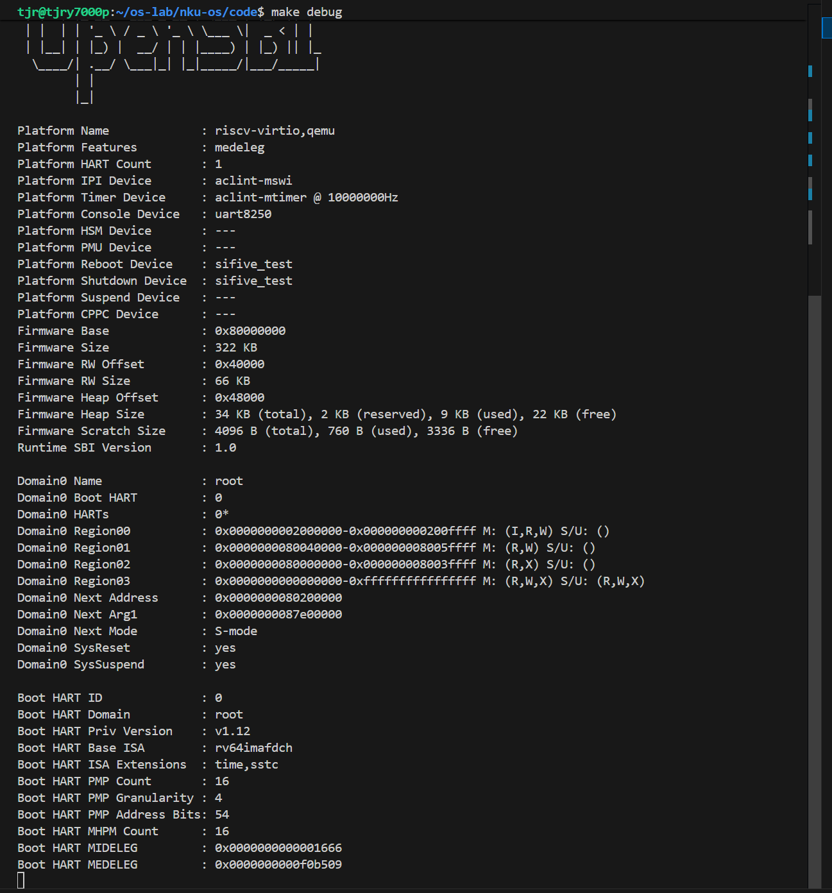
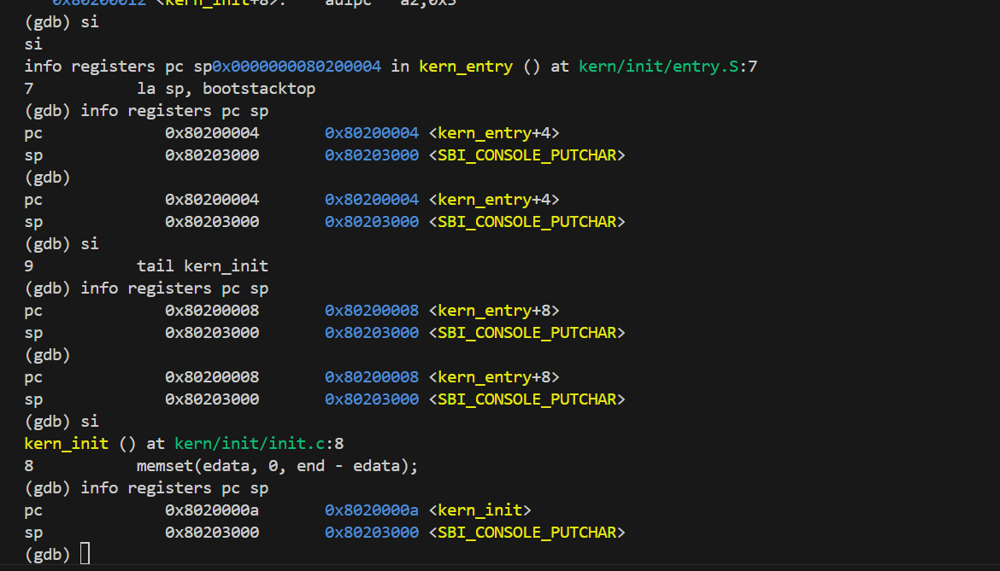
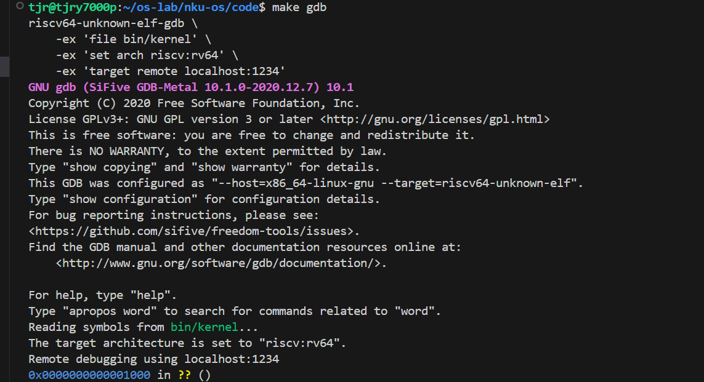
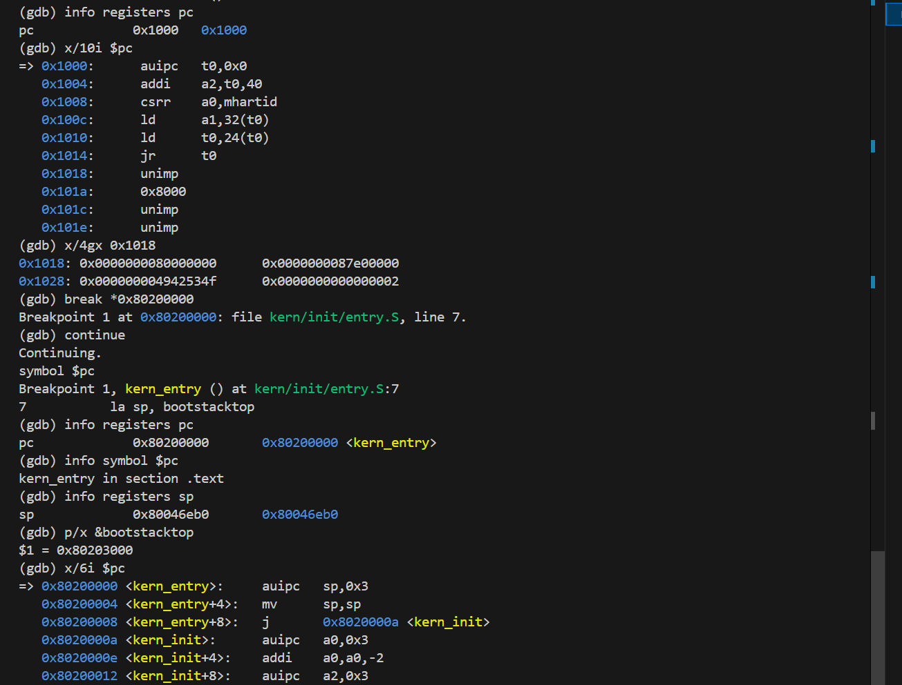
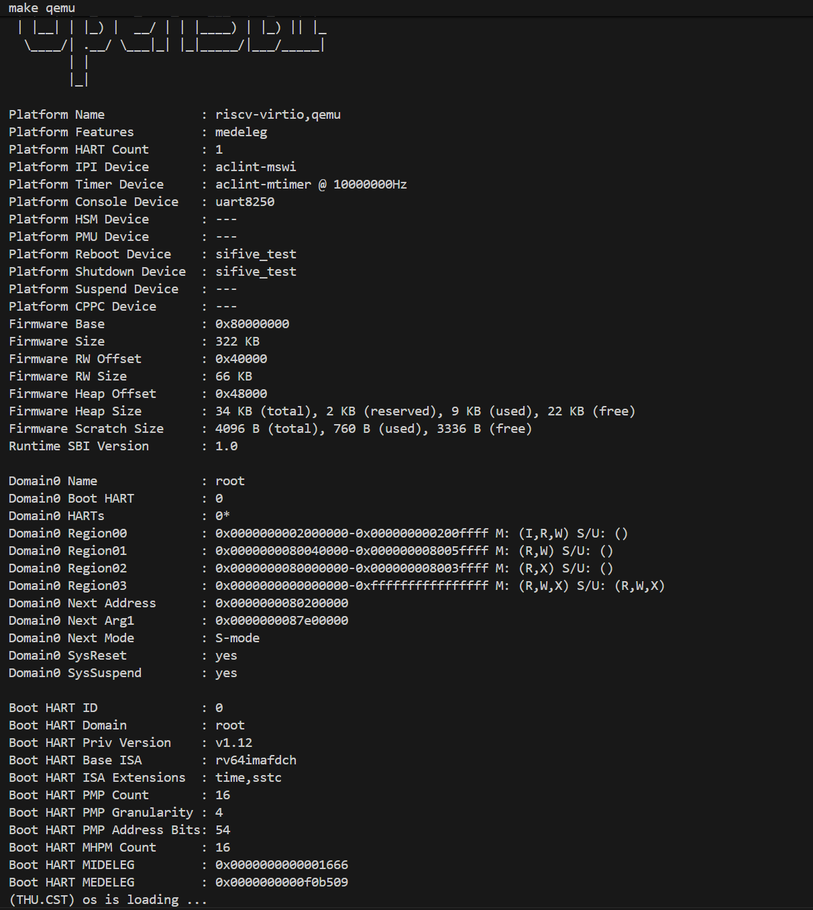

# 操作系统实验报告

## 实验基本信息

| 项目 | 内容 |
|------|------|
| **实验名称** | Lab1：比麻雀更小的麻雀（最小可执行内核） |
| **小组组号** | 96 |
| **小组成员** | 2412771-谭锦睿、2413581-黄奕浩、2411302-王乐之 |
| **组长** | 2412771-谭锦睿 |
| **实验分支** | `lab1` |
| **完成日期** | 2026-10-08 |

### 小组分工

#### 练习如何分工？

| 成员 | 负责的练习/模块 |
|------|----------------|
| 2412771-谭锦睿 | 负责实验整体环境搭建与整合，分析 QEMU/OpenSBI 启动流程，处理 Makefile 启动兼容问题，并完成整体运行验证 |
| 2413581-黄奕浩 | 负责练习1，分析 `kern/init/entry.S`，重点理解 `la sp, bootstacktop`、`tail kern_init`、内核栈大小及其作用 |
| 2411302-王乐之 | 负责练习2，使用 GDB 跟踪从 `0x1000` 到 `0x80200000` 的启动过程，验证 `kern_entry`、栈初始化以及进入 `kern_init()` |

#### 实验报告如何分工？

| 成员 | 报告分工 |
|------|----------|
| 2412771-谭锦睿 | 负责实验整体逻辑、AI 协作过程、QEMU 启动兼容问题、报告整合与最终检查 |
| 2413581-黄奕浩 | 负责练习1相关内容、内核入口与栈初始化原理整理，以及相关 OS 知识点总结 |
| 2411302-王乐之 | 负责练习2 GDB 调试过程、测试与验证部分，以及实验截图整理 |

---

## 一、实验目的

本实验主要围绕“最小可执行内核”和 RISC-V 启动流程展开，目标不是实现复杂的进程、虚拟内存或文件系统，而是先理解一个操作系统内核如何从机器加电开始，逐步获得 CPU 控制权并最终进入 C 语言代码。

本实验的主要目的是：

1. 理解 RISC-V uCore 最小可执行内核从加电复位到进入 `kern_init()` 的完整启动过程；
2. 掌握链接脚本、内核入口地址、内核栈以及 OpenSBI 在启动过程中的作用；
3. 学习使用 QEMU 与 GDB 对内核启动过程进行调试和验证；
4. 学习按照规定的四段式提示词结构使用 AI 辅助分析代码和解决实验环境问题，并通过真实运行结果对 AI 输出进行验证。

---

## 二、实验环境

本实验在 Windows + WSL2 Ubuntu 环境下完成，主要使用 RISC-V 交叉编译工具链、QEMU、OpenSBI、GDB、Git、OpenCode 与 ChatGPT。

| 成员 | AI 编程工具 | 底层模型 | 备注 |
|------|------------|---------|------|
| 2412771-谭锦睿 | OpenCode、ChatGPT | OpenCode：DeepSeek-V4-Flash-Vision-Exp；ChatGPT：GPT-5.6 Sol | 主要用于代码分析、环境问题定位、实验过程复核和报告整合 |
| 2413581-黄奕浩 | ChatGPT | ChatGPT：GPT-6.1 Sol | 负责练习1内容整理与复核 |
| 2411302-王乐之 | Codex | GPT-6.1 Sol | 负责练习2调试过程整理与复核 |

**说明：**

- OpenCode 用于读取当前真实工程文件，并在明确限制范围内执行代码分析或最小修改；
- ChatGPT 主要用于解释操作系统概念、设计提示词、检查调试结果和帮助整理实验报告；
- 所有 AI 输出均通过实际编译、QEMU 运行或 GDB 调试进行人工验证；
- 本实验实际使用过的完整提示词同时记录在 `report/prompt.md` 中。

---

## 三、实验整体逻辑分析

### 3.1 本章节的逻辑主线

Lab1 的核心问题是：**在还没有进程、虚拟内存、文件系统等高级功能之前，一个最小 uCore 内核究竟如何从机器上电开始真正运行起来。**

整个实验的启动链可以概括为：

```text
加电复位
    ↓
CPU 从 0x1000 开始执行 MROM 启动代码
    ↓
跳转到 0x80000000 的 OpenSBI
    ↓
OpenSBI 完成初始化并准备下一阶段
    ↓
跳转到 0x80200000
    ↓
执行 kern/init/entry.S 中的 kern_entry
    ↓
建立 uCore 自己的内核栈
    ↓
跳转到 kern_init()
    ↓
执行 C 语言代码
    ↓
输出 (THU.CST) os is loading ...
```

其中三个地址是理解 Lab1 的关键：

- `0x1000`：QEMU 模拟的 RISC-V CPU 的复位入口；
- `0x80000000`：OpenSBI 固件运行位置；
- `0x80200000`：uCore 内核入口地址。

链接脚本 `code/tools/kernel.ld` 中：

```ld
ENTRY(kern_entry)
BASE_ADDRESS = 0x80200000;
```

指定了内核入口符号和链接基地址，因此 OpenSBI 最终将控制权交给 `0x80200000` 后，就会开始执行 `kern_entry`。

### 3.2 功能的逐步实现

本实验按照下面的顺序完成：

1、**先完成编译与链接**  
   通过 `make` 生成 `bin/kernel` 和 `bin/ucore.img`，保证后续 QEMU 和 GDB 有可以运行和调试的内核产物。

2、**再验证 QEMU/OpenSBI 能否进入 uCore**  
   通过 `make qemu` 检查 OpenSBI 的 `Domain0 Next Address` 和内核输出。当前环境下原有 Makefile 启动方式无法正确进入内核，因此先通过手工命令定位问题，再对 Makefile 做最小修改。

3、**理解 `kern_entry` 的作用**  
   分析 `entry.S` 中的 `la sp, bootstacktop` 和 `tail kern_init`，弄清楚进入 C 语言代码之前为什么必须先准备内核栈。

4、**最后用 GDB 验证整个启动流程**  
   从 `0x1000` 开始观察启动指令，再在 `0x80200000` 设置断点，验证 OpenSBI 将控制权交给内核，并进一步单步执行到 `kern_init()`。

这种顺序先保证“能运行”，再分析“为什么能运行”，最后用调试器验证实际行为，使静态代码分析和动态执行结果能够相互对应。

---

## 四、实验内容与实现

### 功能模块：QEMU/OpenSBI 启动兼容调整

**负责人：** 2412771-谭锦睿

#### 模块功能描述

本模块用于解决当前 QEMU 8.2.2 / OpenSBI v1.3 环境下，原 Makefile 使用 `-device loader` 启动时 OpenSBI 无法正确获得下一阶段入口地址的问题。

**涉及文件/目标：**

```text
code/Makefile
qemu target
debug target
```

**功能说明：**

原 `make qemu` 运行时出现：

```text
Domain0 Next Address : 0x0000000000000000
```

内核没有输出。手工测试 `-kernel bin/ucore.img` 后可以正确得到：

```text
Domain0 Next Address : 0x0000000080200000
(THU.CST) os is loading ...
```

因此需要对 `qemu` 和 `debug` 目标做最小修改，同时保持 `gdb` 目标以及 `debug` 中的 `-s -S` 不变。

#### 最终提示词

以下为本模块实际使用的最终提示词：

````markdown
[PROMPT]

**任务**：修改 `code/Makefile` 中的 `qemu` 和 `debug` 目标，使它们兼容我当前的 QEMU/OpenSBI 环境。

**操作要求**：
- 只修改 `code/Makefile` 中与 `qemu`、`debug` 有关的部分。
- 不修改内核源码。
- 不执行 commit 或 push。
- 修改完成后展示 `git diff`。

**输出要求**：
先简单说明修改原因，再进行最小修改。

[RELY]

当前环境：

- QEMU 8.2.2
- OpenSBI v1.3

当前 `make qemu` 使用：

```makefile
-device loader,file=$(UCOREIMG),addr=0x80200000
```

实际运行时：

```text
Domain0 Next Address : 0x0000000000000000
```

内核没有输出。

但我已经手工验证：

```bash
qemu-system-riscv64 \
  -machine virt \
  -nographic \
  -bios default \
  -kernel bin/ucore.img
```

可以正常得到：

```text
Domain0 Next Address : 0x0000000080200000
(THU.CST) os is loading ...
```

当前 `gdb` 目标通过 `localhost:1234` 连接 QEMU。

[GUARANTEE]

修改后需要保证：

1、`qemu` 使用 `-kernel $(UCOREIMG)` 启动内核；
2、`debug` 也使用 `-kernel $(UCOREIMG)`；
3、`debug` 保留 `-s -S`，供 GDB 连接并在启动时暂停 CPU；
4、`gdb` 目标保持不变；
5、不修改其他无关内容。

[SPECIFICATION]

## qemu

**Post-Condition**：
- `make qemu` 能让 OpenSBI 正确跳转到 `0x80200000`；
- 最终能够运行 uCore。

## debug

**Post-Condition**：
- `make debug` 启动 QEMU 后 CPU 立即暂停；
- QEMU 在 1234 端口等待 GDB；
- 内核仍使用 `-kernel $(UCOREIMG)` 加载。
````

#### 实现迭代过程

##### 第一次迭代

**遇到的问题：**

- 原始 `make qemu` 使用 `-device loader,file=$(UCOREIMG),addr=0x80200000`；
- OpenSBI 显示 `Domain0 Next Address : 0x0000000000000000`；
- uCore 没有输出，说明控制权没有正确进入内核。

**问题解决策略：**

先手工执行：

```bash
qemu-system-riscv64 \
  -machine virt \
  -nographic \
  -bios default \
  -kernel bin/ucore.img
```

验证 `-kernel` 方式能够正确启动，再通过 Prompt 限定 AI 只修改 `qemu` 和 `debug` 目标。

**最终结果：**

修改后：

```makefile
qemu:
    ...
    -kernel $(UCOREIMG)

debug:
    ...
    -kernel $(UCOREIMG) \
    -s -S
```

重新执行 `make qemu` 后：

-  `Domain0 Next Address` 为 `0x80200000`
-  uCore 成功输出 `(THU.CST) os is loading ...`
-  `make debug` 仍可以通过 1234 端口供 GDB 连接
-  没有修改无关内核代码

**关键改进点总结：**

1、在提示词的 `[RELY]` 中提供了真实失败输出和已经验证成功的手工命令；
2、在 `[GUARANTEE]` 中限制修改范围，避免 AI 改动其他目标；
3、修改后通过 `git diff` 和真实 QEMU 运行结果进行二次验证。



---

### 练习1：理解内核启动中的程序入口操作

**负责人：** 2413581-黄奕浩

#### 模块功能描述

练习1要求分析 `kern/init/entry.S` 中：

```asm
la sp, bootstacktop
tail kern_init
```

分别完成了什么操作，以及为什么内核要先建立栈再进入 C 语言的 `kern_init()`。

涉及的主要文件：

```text
code/kern/init/entry.S
code/kern/mm/memlayout.h
code/kern/mm/mmu.h
code/kern/init/init.c
code/tools/kernel.ld
```

#### 最终提示词

````markdown
[PROMPT]

**任务**：阅读 `code/kern/init/entry.S`，结合相关代码完成 Lab1 练习1，解释：

1、`la sp, bootstacktop` 完成了什么操作，目的是什么；
2、`tail kern_init` 完成了什么操作，目的是什么。

**操作要求**：基于当前项目真实代码分析，不修改任何文件。

**输出要求**：先简单分析代码，再给出适合写进实验报告的最终答案。

[RELY]

请结合以下文件中的实际定义进行分析：

- `code/kern/init/entry.S`
- `code/kern/mm/memlayout.h`
- `code/kern/mm/mmu.h`
- `code/kern/init/init.c`
- `code/tools/kernel.ld`

需要关注：

```c
#define PGSIZE 4096
#define KSTACKPAGE 2
#define KSTACKSIZE (KSTACKPAGE * PGSIZE)
```

以及：

```asm
kern_entry:
    la sp, bootstacktop
    tail kern_init
```

和：

```c
int kern_init(void) __attribute__((noreturn));
```

[GUARANTEE]

需要回答：

1、`la sp, bootstacktop` 的作用和目的；
2、`tail kern_init` 的作用和目的；
3、`bootstack`、`bootstacktop` 和 `sp` 的关系；
4、`KSTACKSIZE` 的实际大小；
5、为什么 `kern_init` 不需要返回到 `kern_entry`。

不修改任何源码。

[SPECIFICATION]

## `la sp, bootstacktop`

**Pre-Condition**：
- 已进入 `kern_entry`；
- 已经为启动栈预留空间。

**Post-Condition**：
- `sp` 指向 `bootstacktop`；
- 后续 C 函数可以使用栈。

**Requirements**：
- 说明 `la` 和 `sp` 的含义；
- 说明栈向低地址增长；
- 根据代码计算启动栈大小。

## `tail kern_init`

**Pre-Condition**：
- 栈已经初始化完成。

**Post-Condition**：
- 程序进入 `kern_init` 执行。

**Requirements**：
- 说明 `tail` 的作用；
- 结合 `kern_init` 的 `noreturn` 属性解释为什么这里不需要返回；
- 与普通 `call` 做简单区别即可。
````

#### 练习解答

`sp` 是 RISC-V 的栈指针寄存器。相关定义为：

```c
#define PGSIZE 4096
#define KSTACKPAGE 2
#define KSTACKSIZE (KSTACKPAGE * PGSIZE)
```

因此：

```text
KSTACKSIZE = 2 × 4096 = 8192 B = 8 KiB
```

`entry.S` 中的 `bootstack` 预留了这 8 KiB 空间，`bootstacktop` 表示栈空间的高地址端。RISC-V 的栈向低地址增长，所以：

```asm
la sp, bootstacktop
```

把 `bootstacktop` 的地址装入 `sp`，从而为后续 C 函数调用建立 uCore 自己的启动栈。

GDB 实测：

```text
进入 kern_entry 前：
sp = 0x80046eb0

&bootstacktop = 0x80203000

执行对应机器指令后：
sp = 0x80203000
```

这说明 `sp` 确实被切换到了 uCore 的启动栈。

`tail kern_init` 以尾调用方式跳转到 `kern_init`，不设置返回地址，目的是将控制权从汇编入口交给C函数kern_init，开始执行内核初始化。`kern_init()` 被声明为：

```c
int kern_init(void) __attribute__((noreturn));
```

且函数最后进入无限循环，因此不需要返回到 `kern_entry`。实际反汇编为：

```asm
0x80200000 <kern_entry>:   auipc   sp,0x3
0x80200004 <kern_entry+4>: mv      sp,sp
0x80200008 <kern_entry+8>: j       0x8020000a <kern_init>
```

这里也说明源码中的 `la` 和 `tail` 都属于汇编伪指令，最终会转化为 CPU 真正执行的机器指令。

#### 实现迭代过程

本练习没有修改源码，因此没有代码生成失败的问题。第一次 AI 分析已经得到正确的静态结论，之后又通过练习2的 GDB 单步调试对其进行了动态验证。

**最终结果：**

1、正确计算启动栈大小为 8 KiB
2、明确 `sp`、`bootstack` 和 `bootstacktop` 的关系
3、解释了 `tail kern_init` 与 `noreturn` 的关系
4、使用 GDB 观察到 `sp` 实际变为 `0x80203000`



---

### 练习2：使用 GDB 验证启动流程

**负责人：** 2411302-王乐之

#### 模块功能描述

练习2要求使用 QEMU 和 GDB 从 RISC-V 加电开始进行调试，确认最初执行地址，并一直跟踪到内核入口 `0x80200000`。

#### 最终提示词

````markdown
[PROMPT]

**任务**：分析当前 Lab1 的 GDB 调试方式，告诉我如何完成练习2：从 CPU 加电开始调试，观察最初执行地址，并最终跟踪到内核入口 `0x80200000`。

**操作要求**：
1、阅读当前项目中的 `code/Makefile`、`code/tools/kernel.ld` 和 `code/kern/init/entry.S`。
2、不修改任何文件。
3、不执行 commit 或 push。
4、只分析当前项目真实的 `debug` 和 `gdb` 目标。

**输出要求**：
给出两个终端分别应该执行什么命令，并解释主要 GDB 命令的作用。

[RELY]

当前已经确认：

```text
make qemu
```

能够正常运行，并输出：

```text
Domain0 Next Address : 0x0000000080200000
(THU.CST) os is loading ...
```

当前 `debug` 目标已经改为使用：

```makefile
-kernel $(UCOREIMG) \
-s -S
```

其中：

- `-S`：启动后暂停 CPU；
- `-s`：开放 GDB 调试端口。

`gdb` 目标用于加载 `bin/kernel` 并连接 QEMU。

[GUARANTEE]

需要说明：

1、终端1如何启动 QEMU 调试模式；
2、终端2如何启动 GDB；
3、如何查看当前 PC；
4、如何查看当前地址附近的汇编指令；
5、如何设置 `0x80200000` 断点；
6、如何继续运行直到内核入口；
7、如何确认当前已经进入 `kern_entry`。

不修改任何代码。

[SPECIFICATION]

## 开机位置

**Post-Condition**：
- GDB 连接后能够观察 CPU 当前执行位置；
- 应重点确认最初的 PC 是否位于 `0x1000` 附近。

## 内核入口

**Post-Condition**：
- 在 `0x80200000` 设置断点；
- 继续运行后停在该地址；
- 能结合符号信息确认这里对应 `kern_entry`。

请同时解释 `info registers pc`、`x/10i $pc`、`break *0x80200000`、`continue`、`si` 各自是什么意思。
````

#### 调试过程与练习解答

终端1执行：

```bash
cd ~/os-lab/nku-os/code
make debug
```

`debug` 中：

- `-S` 让 QEMU 创建 CPU 后立即暂停；
- `-s` 在 1234 端口开放 GDB 调试服务。

终端2执行：

```bash
cd ~/os-lab/nku-os/code
make gdb
```

连接成功后：

```text
0x0000000000001000 in ?? ()
```

说明 CPU 加电后停在 `0x1000`。



执行：

```gdb
info registers pc
x/10i $pc
```

得到：

```asm
0x1000: auipc   t0,0x0
0x1004: addi    a2,t0,40
0x1008: csrr    a0,mhartid
0x100c: ld      a1,32(t0)
0x1010: ld      t0,24(t0)
0x1014: jr      t0
```

继续：

```gdb
x/4gx 0x1018
```

得到：

```text
0x1018: 0x0000000080000000
0x1020: 0x0000000087e00000
0x1028: 0x000000004942534f
0x1030: 0x0000000000000002
```

其中 `0x1018` 保存的值为 `0x80000000`。结合：

```asm
ld t0,24(t0)
jr t0
```

可以确认启动代码取得 OpenSBI 的入口地址后跳转到 `0x80000000`。

随后设置内核入口断点：

```gdb
break *0x80200000
continue
```

命中：

```text
Breakpoint 1, kern_entry () at kern/init/entry.S:7
7           la sp, bootstacktop
```

再执行：

```gdb
info registers pc
info symbol $pc
```

得到：

```text
pc = 0x80200000 <kern_entry>
kern_entry in section .text
```

说明 OpenSBI 已经把控制权交给 uCore。



继续单步执行后观察到：

```text
pc = 0x80200004
sp = 0x80203000
```

最终到达：

```text
pc = 0x8020000a <kern_init>
sp = 0x80203000
```

GDB 显示：

```text
kern_init () at kern/init/init.c:8
8           memset(edata, 0, end - edata);
```

因此练习2实际验证出的完整执行链为：

```text
0x1000
    ↓
0x80000000 OpenSBI
    ↓
0x80200000 kern_entry
    ↓
sp = bootstacktop
    ↓
kern_init()
```

#### 实现迭代过程

练习2没有修改源码。AI 首先根据项目真实的 `debug` 和 `gdb` 目标给出调试流程，之后通过真实 GDB 操作逐步确认结果。

**最终结果：**

1、确认 CPU 复位地址为 `0x1000`
2、查看并解释 `0x1000` 附近的启动代码
3、验证 `0x1018` 中保存 `0x80000000`
4、在 `0x80200000` 命中 `kern_entry`
5、单步观察 `sp` 初始化
6、最终进入 `kern_init()`

---

## 五、测试与验证

### 5.1 编译验证

在 `code/` 目录执行：

```bash
make
```

能够正常生成：

```text
bin/kernel
bin/ucore.img
```

说明内核可以成功编译、链接并生成启动镜像。

### 5.2 QEMU 运行验证

执行：

```bash
make qemu
```

OpenSBI 输出中可以看到：

```text
Firmware Base        : 0x80000000
Domain0 Next Address : 0x0000000080200000
Domain0 Next Mode    : S-mode
```

最终出现：

```text
(THU.CST) os is loading ...
```

说明 QEMU → OpenSBI → uCore → `kern_init()` 的完整启动链能够正常运行。



### 5.3 GDB 调试验证

GDB 调试验证了：

```text
0x1000
    ↓
0x80000000 OpenSBI
    ↓
0x80200000 kern_entry
    ↓
sp = 0x80203000
    ↓
kern_init()
```

相关截图：

- `image2.png`：GDB 连接后 CPU 停在 `0x1000`；
- `image3.png`：从启动代码跟踪到 `0x80200000 <kern_entry>`；
- `image4.png`：单步验证栈初始化并进入 `kern_init()`；
- `image5.png`：最终 QEMU 运行成功。

本实验未额外使用 `make grade`，主要通过 `make`、`make qemu` 和 GDB 调试结果完成验证。

---

## 六、实验总结与收获

### 对操作系统的理解

本实验中最重要的知识点包括 CPU 启动、PC、链接脚本、OpenSBI、内核入口、内核栈、ELF 和调试符号等。

首先，CPU 并不会在加电后直接执行 `kern_init()`。实验中实际观察到 PC 首先位于 `0x1000`，随后控制权转移到 `0x80000000` 的 OpenSBI，最后才进入 `0x80200000` 的 uCore。这个过程让我把原来比较抽象的“操作系统启动”具体到了真实地址和真实指令。

其次，`kernel.ld` 决定了内核各 section 的布局以及入口位置。源码中的函数名并不能单独决定运行地址，最终地址需要经过编译和链接确定。

再次，进入 C 语言内核代码前必须准备栈。练习1中通过代码分析得出 `la sp, bootstacktop` 的作用，练习2又通过 GDB 实际观察到 `sp` 从 OpenSBI 留下的地址变为 `0x80203000`，使静态分析和实际执行结果对应起来。

另外，本实验也区分了 `bin/kernel` 和 `bin/ucore.img` 的用途：前者是带调试符号的 ELF 文件，适合 GDB 调试；后者是用于 QEMU 启动的内核镜像。

Lab1 的作用是先建立一条最基本的内核启动链，为后续这些功能提供运行基础。

### AI 协作开发的经验

本次实验中，AI 最有价值的作用不是直接替代实验操作，而是帮助整理分析思路、阅读真实工程代码以及定位环境兼容问题。

在练习1和练习2中，提示词都要求 AI 基于当前项目真实文件进行分析，并限制“不修改源码”或“不执行 commit/push”，这样可以减少 AI 对工程做出无关修改的可能。

QEMU 启动问题则体现了“AI 输出必须验证”这一点。原始 `make qemu` 不能进入内核时，并没有直接让 AI 随意修改 Makefile，而是先通过手工命令确认 `-kernel bin/ucore.img` 在当前环境下确实能够成功启动，再把失败现象、成功命令和修改范围一起放入提示词。AI 完成最小修改后，再通过 `git diff` 和 `make qemu` 验证结果。

因此，本次实验中形成的 AI 协作方式可以总结为：

```text
先理解实验要求
    ↓
提供最小且可信的工程上下文
    ↓
明确限制 AI 的修改范围
    ↓
AI 分析或修改
    ↓
检查 diff
    ↓
通过编译、QEMU、GDB 实际验证
```

这种方式更有利于保持对代码和操作系统原理的理解，也便于发现 AI 输出中可能存在的问题。
